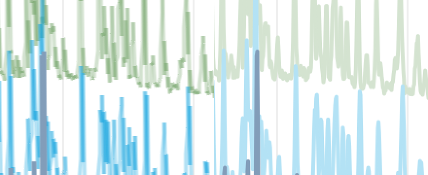
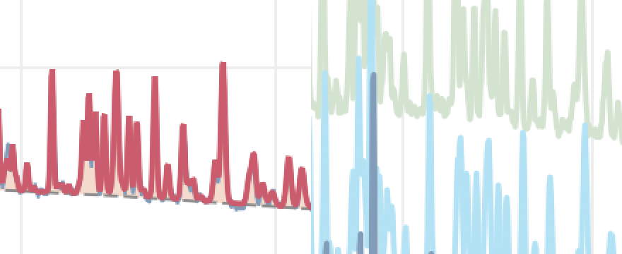

# Scan view timings

How long the Stacked and Map views ([ADR-0041](../adrs/0041-scan-pattern-views.md)) take to redraw on the
324-file scan, what a 162-file sequential fit costs with "Every pattern" updates against "Adaptive"
([ADR-0029](../adrs/0029-following-a-scan-latest-finished-file.md)), and what one step of the Analysis slider costs
before and after a fit. The first table set is the baseline: the views as they drew before the GPU renderer, with
`QPainter` in `ScanLayer`.

## Tools

| Tool | Run it with | What it times |
| --- | --- | --- |
| The app's demo | `edi_app --demo <dir> --demo-only perf-views` (also `perf-gpu-views`, `perf-fit-`, `perf-slider`) | the real views, fits and slider in the app, each change to its frame |
| `edi_app_scan_bench` | `pixi run -e app app-scan-bench`, or `build/app/app/edi_app_scan_bench <scan dir> <png or ''> <a, b or p> <column share> <width px>` | the Stacked view's three candidate renderers on the 324-file scan |
| `edi_app_plot_bench` | `pixi run -e app plot-bench`, with `-- --workloads <names>` or `--routes <names>` for a part | every way of feeding Qt Graphs, and the references, on four workloads; writes `build/plot-bench/<machine>-<platform>-<renderer>.tsv` |
| `plot_bench_compare.py` | `pixi run -e app plot-bench-compare a.tsv b.tsv` | two machines' tables side by side |

Each logs every change as it runs and stops early when its window is not drawn: keep the window visible and uncovered
on a desktop. On Linux without a display, `plot-bench` draws on the UI test's own X server. Why each choice was made is
in [ADR-0041](../adrs/0041-scan-pattern-views.md) §9 and its alternatives; the numbers are below.

## How the numbers are taken

The app's demo mode times them (`app/src/demo_driver.cpp`, the `perf-` steps):

```
edi_app --demo <dir> --demo-only perf-views    # the views on pd-neut-cwl_cosio-d20_scan-324f
edi_app --demo <dir> --demo-only perf-fit-     # the 162-file fit, four ways
edi_app --demo <dir> --demo-only perf-slider   # 30 slider steps on LBCO, before and after a fit
```

A view change is timed from the change to the swap of the first frame whose scene synchronisation followed it, so
the time holds the QML bindings, the drawing and the frame. Each view change runs from an idle window. The changes:

| Change | What it does |
| --- | --- |
| zoom | x range to its middle half and back |
| pan | a window half the x range wide, moved a fiftieth of the range per step |
| restyle | the colours reversed (Stacked) or the colour map reversed (Map) |
| select | another dataset shown |
| data | every dataset's points published again (the x axis placed anew, d and back where a calculation gives d): each trace reduced and drawn from scratch; the demo fails the step unless every Stacked trace is rebuilt |
| rows | the rows placed again, by file and by scan value: every dataset's row moves, its trace kept (what `data` timed before edi cc48501a) |

A slider step moves the selected parameter (the LBCO cell length a) by 1 to 5 % of the slider's range and is timed to
the frame after its calculation ended ("shown"), and to the calculation's end ("calculated"). A fit is timed from its
start to its end being published with nothing calculating, after the demo checks every file was fitted.

`app/tools/scan_bench.cpp` (`pixi run -e app app-scan-bench`) compares the renderers outside the app, on the same
324 files, as one table.

Every number below is the median of three runs, each run's value the median of its samples. The raw rows are in
`scan-view-timings/`: each run's medians ([baseline](scan-view-timings/baseline/medians.tsv)), every timed change
([baseline](scan-view-timings/baseline/samples.tsv)) and when each run ran
([baseline](scan-view-timings/baseline/runs.tsv)).

**Machine: the no-GPU case.** A Linux VM, 64 vCPUs (Intel Xeon, Cascade Lake), 31 GB, no GPU. The app runs on X
(Xwayland on headless Weston) with Mesa llvmpipe drawing OpenGL on the CPU, as the UI test captures do, pinned to 8
vCPUs. A user without a GPU sees this case, so the redraw target holds here as well as on a GPU. Other work
shared the machine: the load average was 4 to 18 during the runs it was recorded for (not the view runs). GPU
numbers are taken where a GPU exists (the macOS CI runner).

## Baseline, no GPU

The views, 324 patterns of about 1 500 points each, a plot 1 000 pixels wide, in milliseconds:

| Change | Stacked median | Stacked p95 | Map median | Map p95 |
| --- | ---: | ---: | ---: | ---: |
| zoom | 114.6 | 131.0 | 57.0 | 70.1 |
| pan | 110.5 | 130.0 | 42.3 | 66.0 |
| restyle | 526.9 | 593.3 | 39.2 | 50.1 |
| select | 88.7 | 93.9 | 39.0 | 42.4 |
| data | 1 829.5 | 3 252.9 | 1 983.9 | 3 680.4 |

The 162-file fit, in seconds (three interleaved rounds):

| Tab shown | Every pattern | Adaptive | Every pattern / Adaptive |
| --- | ---: | ---: | ---: |
| Pattern | 53.85 (53.84–66.28) | 22.37 (18.71–23.88) | 2.41 |
| Stacked | 16.68 (16.55–18.36) | 17.13 (16.76–17.78) | 0.97 |

A slider step on LBCO, in milliseconds:

| | Before the fit | After the fit |
| --- | ---: | ---: |
| shown | 210.4 | 229.5 |
| calculated | 75.9 | 79.8 |

## Where the time goes

Read from Qt's render loop timing (`QT_LOGGING_RULES=qt.scenegraph.time.renderloop=true`) and the QML involved:

- **Drawing the Stacked view** happens in the scene synchronisation, which blocks the GUI thread: `ScanLayer::paint`
  reduces and strokes all 324 patterns every time, whatever changed. That is most of a zoom or pan frame.
- **A data change** costs over a second, mostly outside the drawing: the row labels' model is the rows' texts, so the
  Repeater deletes and makes again all 324 labels, each label's colour calls `colourOf`, and every row tick does too.
- **A restyle** reads `colourOf` for 324 labels and 324 ticks, and each call builds the colour table again.
- **A change of the shown dataset redraws every pattern**, although the drawing does not use it (the selection box
  is a separate item): a followed scan redraws all 324 patterns for every file.
- **"Every pattern" with the Pattern tab shown** waits about 0.2 s per file for the pattern chart to draw
  ([ADR-0029](../adrs/0029-following-a-scan-latest-finished-file.md) §8). With the Stacked tab shown nothing waits.

## The renderers compared, no GPU

`scan_bench` on the same 324 patterns, plot 1 000 columns wide, each change timed to its frame as above, 30 changes
of each kind per run. Candidates: **a**, Qt Graphs, a `LineSeries` per pattern fed its reduced trace in one
`replace()`; **b**, `ScanLines`, a scene-graph node of quads per 64 patterns, its shader placing each pattern's line,
so an offset, height or colour change gives the shader new values and no new vertices; **p**, the way the view draws
today, every pattern stroked with `QPainter` into the item's image on each change. Medians of three runs, in
milliseconds ([rows](scan-view-timings/renderers.tsv)):

| Candidate | Width | First | x range | Restyle | Offset |
| --- | ---: | ---: | ---: | ---: | ---: |
| a, Qt Graphs | 2 px | 2 853 | 2 151 | no frame | 2 156 |
| a, Qt Graphs (one run) | 1 px | 2 496 | 2 486 | no frame | 2 382 |
| b, ScanLines | 2 px | 489 | 358 | 258 | 341 |
| b, ScanLines | 1 px | 576 | 479 | 262 | 240 |
| p, QPainter | 2 px | 3 174 | 3 090 | 3 159 | 2 983 |
| p, QPainter | 1 px | 134 | 124 | 128 | 126 |

"x range" is a new x range, every trace reduced again (a zoom or pan step); reducing the 324 traces takes 6 to 8 ms
of it. "No frame": after a colour change alone, Qt Graphs drew no frame within 10 s.

- Qt Graphs misses the 100 ms target by twenty times on every change.
- ScanLines costs about the same at either width: llvmpipe's cost is its vertices (four per segment, about 1.9
  million), not its pixels. A first build with one node per pattern took about 500 ms for a restyle; one node per 64
  patterns took it to about 260 ms.
- QPainter strokes a 1 px antialiased line on a fast path and a 2 px one through its general stroker, 25 times
  slower. At 324 rows in about 600 pixels the view draws 1 px lines (ADR-0041 §4), so without a GPU the painter is
  today's fastest path, at about 125 ms.
- None meets 100 ms without a GPU yet.

## The renderers compared, with a GPU

The same benchmark on an Apple M2 (macOS, Metal through Qt Quick, a Retina screen: the plot 2 000 device pixels wide,
so no pattern is reduced), run by the owner on 2026-10-25, one run each
([rows](scan-view-timings/renderers-gpu.tsv)), in milliseconds:

| Candidate | Width | First | x range | Restyle | Offset |
| --- | ---: | ---: | ---: | ---: | ---: |
| a, Qt Graphs | 2 px | 1 008 | 492 | no frame | 495 |
| b, ScanLines | 1 px | 147 | 16.7 | 8.2 | 8.2 |
| p, QPainter | 1 px | 72 | 66.5 | 66.5 | 66.4 |

ScanLines meets the target with a GPU, at about one frame of a 120 Hz screen for a restyle or an offset, four to eight
times faster than the painter. A second run reported by the owner gave b 26.5 ms for the first population (the first
run's 147 ms held one-time start-up) and the same changes.

## Why Qt Graphs is slow here

Timed in one run of candidate a without a GPU, each change split by Qt's render loop timing: our side of a change, the
324 traces reduced and handed over with one `replace()` per series, takes a median 7.5 ms (at most 29 ms); Qt Graphs then
takes a median 1 355 ms preparing the frame on the GUI thread (its polish), 193 ms rendering it and 501 ms in llvmpipe
before the swap. So the time is Qt Graphs' handling of 324 series, not the feeding.

A colour change alone does not make Qt Graphs draw (6.11): `setColor` schedules no frame, so the restyles drew nothing
in the runs above. The benchmark now emits the series' `update()` signal after the colour, and a restyle then draws in
about 2 s without a GPU, as the other changes do.

## Every way of feeding Qt Graphs

`plot_bench` (`app/tools/plot_bench.cpp`; `pixi run -e app plot-bench`, `pixi run -e app plot-bench-compare a.tsv
b.tsv`) times each route into Qt Graphs 6.11 on four kinds of work, with ScanLines and QPainter as references where
only lines are drawn. The routes: `replace(QList<QPointF>)` from C++; `clear()` then `append(QList<QPointF>)`;
`clear()` then `append(QPointF)` per point; `replace(index, QPointF)` per point where the count holds; a
`QXYModelMapper` over a C++ table model; and the points handed to QML, which calls `replace(points)` or appends them
one by one. `QCustomSeries` is not a route for a curve: it makes one Qt Quick item per data item. The work:

| Workload | What |
| --- | --- |
| stacked-324, -1000, -3000 | the 324-file scan's patterns, repeated, each reduced at the plot's pixel columns |
| single-10000, -100000, -1000000 | one band, the LATP measurement ± its s.u. interpolated to N points, fed whole |
| pattern | the LATP pattern calculated with five structures (its three, then the first two at half intensity), as the Pattern chart presents it in band mode: the measured band, a filled profile per structure, the total and the background, the residual band and the ticks, 14 curves, 7 of them areas |

Each measure is five changes, at most 10 s of them; a route slower than 2 s per change at one size is skipped at the
larger ones. Two machines: the no-GPU VM above, its plot 1 000 columns, at 8904d687
([rows](scan-view-timings/plot-bench-linux-vm-xcb-llvmpipe.tsv)); and the owner's M2 (macOS, Metal, a Retina plot of
2 000 columns), run by the owner on 2026-10-25 at the same commit, its table verbatim but the machine's name
([rows](scan-view-timings/plot-bench-owner-m2-cocoa-metal.tsv)). Medians in milliseconds; * marks a measure the budget
cut short, "no frame" one that drew nothing within three times its first draw. Every measure side by side, as
`plot-bench-compare` prints it: [VM against M2](scan-view-timings/plot-bench-compare-vm-m2.txt).

The Stacked view (M2 from the owner's earlier run of the whole table at d5eaf916, ten changes per measure, stopped
during stacked-3000; medians from his log as reported, not in the rows file):

| Route | stacked-324 update, no GPU | stacked-324 update, M2 | stacked-1000 update, no GPU | stacked-1000 update, M2 |
| --- | ---: | ---: | ---: | ---: |
| cpp-replace | 2 283 | about 545 | skipped | about 3 700 to 3 900 |
| cpp-append-list | 2 115 | about 540 | skipped | about 3 700 to 3 900 |
| qml-replace | 2 724* | about 538 | skipped | about 3 700 to 3 900 |
| cpp-replace-index | 6 545* | about 2 250 | skipped | |
| cpp-append-point | 5 909* | about 2 250 | skipped | |
| qml-append | 7 236* | about 2 620 | skipped | |
| model-mapper | no frame | no frame | no frame | |
| ScanLines | 508 | about 19.6 | 2 101 | about 35.5 |
| QPainter | 134 | about 62.6 | 338 | about 187 |

At stacked-3000 without a GPU only QPainter ran (986 ms per update); every other route was skipped.

**pattern**

| Route | Update, no GPU | Update, M2 | Restyle, no GPU | Restyle, M2 |
| --- | ---: | ---: | ---: | ---: |
| cpp-replace | 466 | 89.8 | 248 | 35.7 |
| cpp-append-list | 420 | 84.8 | 224 | 36.8 |
| cpp-append-point | 484 | 96.5 | 261 | 34.7 |
| cpp-replace-index | 436 | 96.8 | 206 | 35.5 |
| model-mapper | 449 | 113 | 203 | 35.0 |
| qml-replace | 353 | 84.8 | 206 | 34.8 |
| qml-append | 498 | 119 | 164 | 35.0 |

**single-10000**

| Route | Update, no GPU | Update, M2 | Restyle, no GPU | Restyle, M2 |
| --- | ---: | ---: | ---: | ---: |
| cpp-replace | 185 | 44.1 | 119 | 19.8 |
| cpp-append-list | 229 | 38.0 | 113 | 19.4 |
| cpp-append-point | 201 | 38.2 | 117 | 19.0 |
| cpp-replace-index | 188 | 39.9 | 104 | 19.8 |
| model-mapper | 205 | 42.0 | 101 | 18.9 |
| qml-replace | 187 | 36.7 | 89.3 | 19.4 |
| qml-append | 329 | 46.9 | 129 | 19.6 |

**single-100000**

| Route | Update, no GPU | Update, M2 | Restyle, no GPU | Restyle, M2 |
| --- | ---: | ---: | ---: | ---: |
| cpp-replace | 2 030 | 268 | 1 031 | 152 |
| cpp-append-list | 1 742 | 273 | 838 | 152 |
| cpp-append-point | 2 181 | 295 | 854 | 153 |
| cpp-replace-index | 2 043 | 294 | 858 | 154 |
| model-mapper | 1 779 | 331 | 775 | 151 |
| qml-replace | 1 584 | 275 | 794 | 151 |
| qml-append | 1 878 | 388 | 932 | 153 |

**single-1000000**

| Route | Update, no GPU | Update, M2 | Restyle, no GPU | Restyle, M2 |
| --- | ---: | ---: | ---: | ---: |
| cpp-replace | – | 1 118 | – | 918 |
| cpp-append-list | 6 313* | 1 085 | 6 447* | 932 |
| cpp-append-point | – | 1 346 | – | 918 |
| cpp-replace-index | – | 1 334 | – | 924 |
| model-mapper | 8 707* | 1 696 | 7 404* | 937 |
| qml-replace | 8 193* | 1 079 | 7 466* | 928 |
| qml-append | 13 003* | 2 058 | 8 755* | 945 |

What the tables say:

- **The route hardly matters.** On one band every route but one costs about the same, about 1.5 µs per point on the
  M2 and about 10 µs without a GPU (single-100000, 200 000 points with its lower line: 268 to 331 ms on the M2, 1.6 to
  2.2 s without a GPU). Appending point by point from QML is the slowest, up to twice the others on the M2 and three
  times on the stacked patterns without a GPU. On the M2 `replace` from C++, `append` of a list and `replace` from QML
  are the fastest and within 10 % of each other.
- **A restyle feeds no point and still costs half an update or more.** It only sets the colour and asks Qt Graphs to
  draw, yet Qt Graphs prepares every point of every series again (1 000 000 points: 918 ms against 1 118 ms for an
  update on the M2). So a restyle cannot be made cheaper by not feeding: only fewer points help.
- **Qt Graphs cannot draw the Stacked view.** Its time grows with the number of series: about 0.5 s for 324 patterns and
  about 3.8 s for 1 000 on the M2. ScanLines takes 20 to 36 ms there; without a GPU QPainter is the faster of the two.
- **The Pattern chart already reduces its curves.** `present_pattern` keeps each pixel column's lowest and highest point
  (`decimate`), so a pattern of a million points reaches Qt Graphs as at most two points per column per curve, the
  `pattern` workload's case: 85 to 119 ms per update on the M2 and 350 to 500 ms without a GPU for 14 curves.

## The Stacked lines' quality

The owner compared Stacked with the Pattern tab on an M2 (2026-10-25): the Stacked lines were stair-stepped, uneven
and notched at peaks. The causes, read from captures of the same three cosio patterns on both charts
(`edi_app --demo <dir> --demo-only lines-` at `QT_SCALE_FACTOR` 1 and 2, with `EDI_DEMO_ANY_RATIO=1`):

- the trace was reduced to item pixel columns, half a device pixel ratio 2 screen's, and each column drawn as a
  vertical stroke from its lowest to its highest value, which drew stairs where the Pattern chart draws the points;
- on the GPU each segment was a quad ending at its points, leaving a notch at every outer join and overlapping at the
  inner one, and faded lines were translucent, so every overlap was darker;
- the painter's pen was cosmetic, its width in device pixels, so at ratio 2 its line was half the Pattern chart's.

[ADR-0041](../adrs/0041-scan-pattern-views.md) §9 says how each is fixed. At ratio 2, before (left) and after (right):



The Pattern chart's line (left) and the Stacked lines after (right), same scale, both 2 px wide:



**What it costs**, on the no-GPU machine above, 324 patterns, the two builds run in turn three times (edi 5cb96806,
the lines as they were, against 5e8f2d0d), medians of the three runs' medians in milliseconds; every run's medians are
in [frames.tsv](scan-view-timings/lines/frames.tsv) and when each ran in [runs.tsv](scan-view-timings/lines/runs.tsv):

| Path | Change | Before | After | After / before |
| --- | --- | ---: | ---: | ---: |
| Painter (no GPU, the default here) | zoom | 142.0 | 170.3 | 1.20 |
| | pan | 123.7 | 122.6 | 0.99 |
| | restyle | 108.3 | 112.2 | 1.04 |
| | select | 96.1 | 83.0 | 0.86 |
| | data | 763.6 | 1 001.8 | 1.31 |
| GPU lines on llvmpipe | zoom | 446.9 | 635.5 | 1.42 |
| | pan | 308.4 | 422.1 | 1.37 |
| | restyle | 457.4 | 688.8 | 1.51 |
| | select | 291.4 | 378.2 | 1.30 |
| | data | 1 067.8 | 1 786.0 | 1.67 |

The painter now strokes every point while a column holds no more than four, about 1.5 times as many on this scan,
which is most of the zoom and data cost. The GPU rows are the shader rasterised on the CPU, slower per pixel and with
quads a pixel longer at each end; that path is not the default without a GPU. Its cost on a real GPU is taken with
`edi_app --demo <dir> --demo-only perf-gpu-views` on the M2. The load average was 6.6 to 22 during these runs (runs.tsv), so the shares are approximate.

## Gate 1: a change redrawn

With a GPU every change is drawn in under 100 ms (the owner, 2026-10-25); without one, a data change in at most 250 ms
and a zoom, pan, restyle or selection in about 100 ms, a zoom up to 115 ms. Each figure is the time from the change to
its frame on the 324-file D20 scan, in milliseconds.

### With a GPU

The owner's M2 (macOS, Metal, "edi: graphics: Metal, hardware rendering"), 2026-10-26 about 06:14 CET, edi 65f05185 (the
branch as pulled then; crysta SDK 844a30d5, gui-components b008de4e), with
`pixi run -e app app --demo <dir> --demo-only perf-gpu-views`. The timings as the app wrote them are in
[m2-gpu-timings.tsv](scan-view-timings/gate1/m2-gpu-timings.tsv); the per-frame file stayed on the M2.

| View | Change | Median | p95 | Max | Missing |
| --- | --- | ---: | ---: | ---: | ---: |
| Stacked | zoom | 45.1 | 57.5 | 60.5 | 0 |
|  | pan | 37.1 | 43.2 | 45.2 | 0 |
|  | restyle | 27.7 | 42.8 | 45.2 | 0 |
|  | select | 28.2 | 37.8 | 50.0 | 0 |
|  | data | 76.8 | 89.2 | 108.6 | 0 |
| Map | zoom | 45.0 | 48.3 | 56.9 | 0 |
|  | pan | 17.3 | 64.1 | 103.4 | 0 |
|  | restyle | 17.2 | 23.4 | 23.8 | 0 |
|  | select | 16.9 | 23.4 | 23.8 | 1 |
|  | data | 70.8 | 80.6 | 112.1 | 0 |

Every median and every p95 is under 100 ms; the slowest p95 is the Stacked "data" row, 89.2 ms. Three single frames went
over: that Stacked row at 108.6 ms, the Map's at 112.1 ms and a Map pan at 103.4 ms. One Map selection had no frame
measured (missing 1). The "data" rows here timed the row reorder (now `rows`, the table above), not a data change; the
data change is measured again with the step that rebuilds every trace.

### Without a GPU

The painter on this machine's llvmpipe, `edi_app --demo <dir> --demo-only perf-views` three times in turn, pinned to
eight cores, at edi 75a6c618. The load average was 3.9 at the first run and rose to 8.4 by the end of the third. Each
run's median, in milliseconds ([timings](scan-view-timings/gate1/software-timings.tsv)):

| View | Change | Run 1 | Run 2 | Run 3 | Median of the runs | Bound |
| --- | --- | ---: | ---: | ---: | ---: | --- |
| Stacked | zoom | 109.4 | 104.5 | 106.3 | 106.3 | ≤ 115 |
|  | pan | 88.4 | 93.8 | 99.9 | 93.8 | about 100 |
|  | restyle | 63.5 | 71.5 | 85.7 | 71.5 | about 100 |
|  | select | 74.2 | 72.5 | 91.2 | 74.2 | about 100 |
|  | data | 215.6 | 209.8 | 251.1 | 215.6 | ≤ 250 |
| Map | zoom | 68.9 | 68.5 | 74.0 | 68.9 | ≤ 115 |
|  | pan | 52.1 | 53.5 | 54.1 | 53.5 | about 100 |
|  | restyle | 35.0 | 38.4 | 40.6 | 38.4 | about 100 |
|  | select | 38.0 | 38.8 | 41.9 | 38.8 | about 100 |
|  | data | 181.9 | 202.8 | 208.5 | 202.8 | ≤ 250 |

Every median of the runs is within its bound. One run's figure is not: the third run's Stacked "data" row, 251.1 ms,
with the load rising from 5.3 to 8.4. As above, the "data" rows timed the row reorder (now `rows`), not a data change,
which is measured again with the step that rebuilds every trace.

## The 162-file fit with the two Every-pattern choices

"Every pattern" became two choices (the owner, 2026-10-24; [ADR-0029](../adrs/0029-following-a-scan-latest-finished-file.md)
§8): **fit waits for the display**, as before, and **display catches up**, which never makes the fit wait. Gate 2 bounds
the second at 1.05 times Adaptive on the Stacked tab. The fit is timed from its start to its end, without the drawing a
catching-up display still does after it (`edi_app --demo <dir> --demo-only perf-fit-`, the `perf-fit-catchup-` steps).

### Gate 2 on an M2

The owner's M2 (macOS, Metal, a quiet machine), 2026-10-26 about 10:27 CET, crysta SDK build-18823483, with the two modes
alternating so a slow stretch falls on both:
`for r in 1 2 3; do for m in catchup adaptive; do pixi run -e app app --demo <dir>/r$r-$m --demo-only perf-fit-$m-stacked; done; done`.
The whole 162-file fit on the Stacked tab, in milliseconds ([m2-fits.tsv](scan-view-timings/gate2/m2-fits.tsv)):

| Round | Display catches up | Adaptive | Catches up / Adaptive |
| --- | ---: | ---: | ---: |
| 1 | 3 262 | 3 192 | 1.022 |
| 2 | 3 192 | 3 133 | 1.019 |
| 3 | 3 202 | 3 213 | 0.997 |

The median ratio is 1.019, inside the bound. The M2 built edi 899e3336, whose files are those of 7e4a6bf4 on this branch
(only commit messages and a comment line in the runtimes table were reworded since). Since then the chart theme's
tick-label fonts and the moment a followed file's name, count and receipt are taken (the start of the frame that shows
its points, not after it) changed. Neither touches the fit, which in both modes never waits for the display on the
Stacked tab, so neither moves the ratio.

### This machine, under load

Without a GPU the Stacked view's lines are a full repaint for every file the display catches up with, competing with the
fit for the same cores, so the ratio here follows the machine's load. Edi e974b6ed, the modes in turn, in seconds
([fits.tsv](scan-view-timings/gate2/fits.tsv)), the load average 2 to 24 across the rounds:

| Tab shown | Display catches up | Fit waits for the display | Adaptive | Catches up / Adaptive |
| --- | ---: | ---: | ---: | ---: |
| Pattern (3 rounds) | 17.39 (17.01–22.15) | 35.07 (26.67–62.55) | 19.28 (19.19–19.54) | 0.90 |
| Stacked (6 rounds) | 17.00 (16.44–19.14) | 16.21 (15.84–16.67), 3 rounds | 16.10 (15.90–17.44) | 1.06 |

The Stacked rounds' ratios were 1.06, 1.18 and 1.08 at load 4 to 24, then 1.02, 1.02 and 1.05 at load 2 to 8. These are
diagnostics, not gate 2's evidence: the bound is judged on the M2 above. On the Pattern tab the drawing is a pattern
chart's and the fit is not slower than Adaptive's. Fit waits for the display on Stacked was measured before it showed
each file there (ADR-0029 §8), so its column is not today's.
