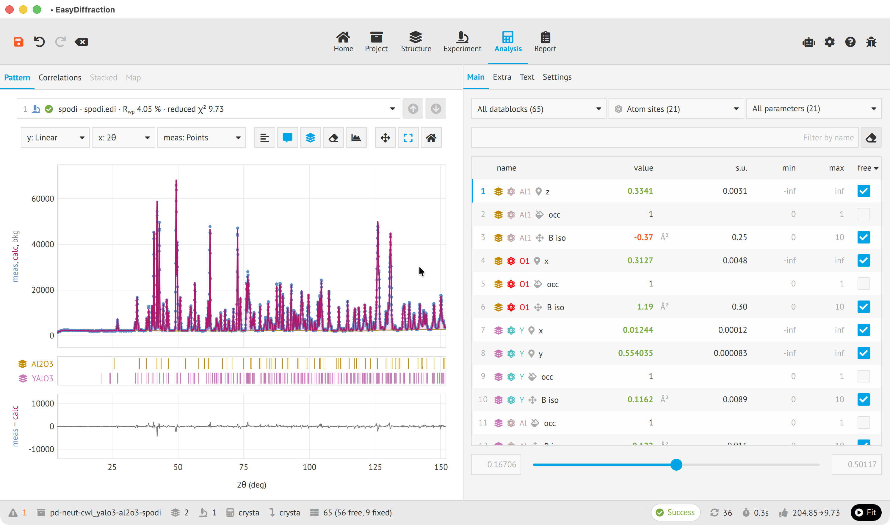

<section class="ed-landing" aria-labelledby="landing-heading" markdown>

<nav class="ed-landing__interfaces" aria-label="Explore EasyDiffraction interfaces" markdown>

[:lucide-globe: :lucide-monitor: Application](application/index.md "Web and desktop app documentation"){ .ed-interface-link .ed-icon-label }
[:simple-python: :simple-jupyter: Python](python/index.md "Python library documentation"){ .ed-interface-link .ed-icon-label }
[:lucide-square-terminal: :simple-python: Command Line](cli/index.md "Command Line documentation"){ .ed-interface-link .ed-icon-label }

</nav>

# Making diffraction data analysis and modelling easy { #landing-heading }

Calculate diffraction patterns, refine your structural model and understand your results. Need a hand? Select AI assistant when you install the desktop app.

[Try the web app](https://enhantica.github.io/edi/webapp/){ .md-button .md-button--primary }
[Learn more](user-guide/index.md){ .md-button }

<figure class="ed-landing__preview">
  
</figure>

</section>
