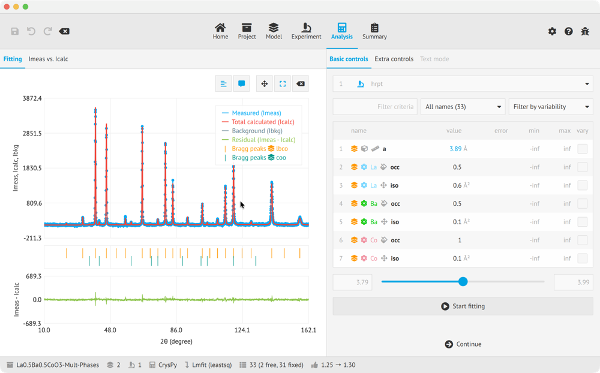
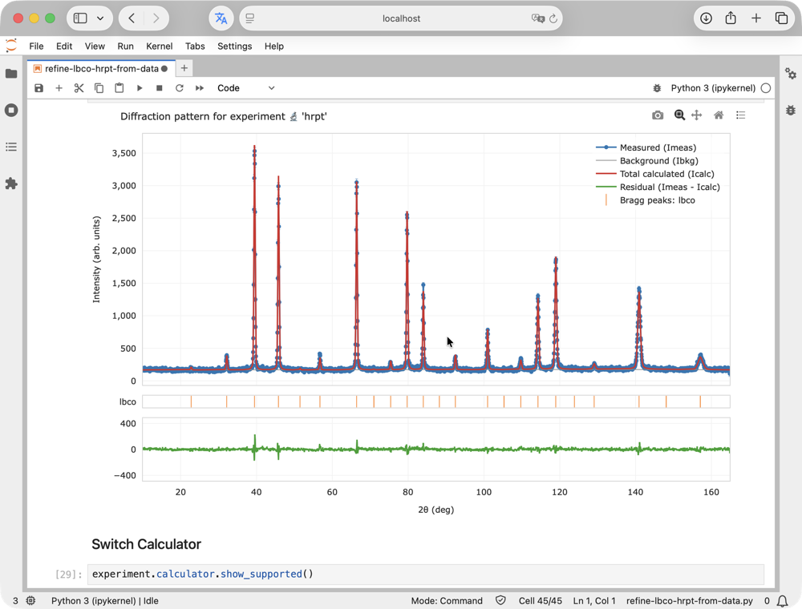
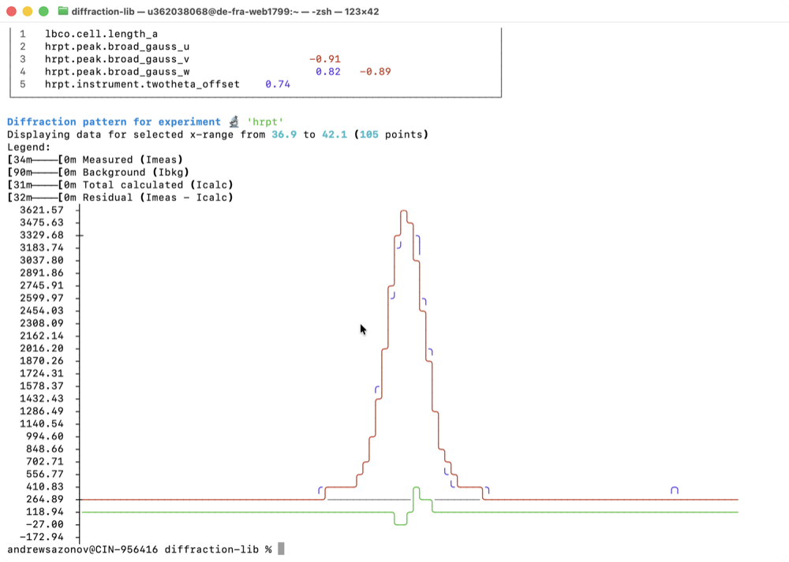

# Foundations

EasyDiffraction calculates diffraction patterns from crystallographic models and refines selected model parameters against measured observations. It helps you connect a proposed structure with experimental evidence and retain the choices behind the result. This guide explains the model and workflow shared by every interface.

## One product, several ways to work

The application provides a visual workspace in a browser or on a desktop. Python supports scripts and notebooks. The command line runs analyses declared by saved projects. These interfaces use the same project model and current diffraction engine.

<figure markdown="1">
<figcaption markdown="1">[:fa5-desktop: Application](../application/index.md){ .ed-interface-head .ed-icon-label .ed-interface-link } Click through the workflow</figcaption>

</figure>
<figure markdown="1">
<figcaption markdown="1">[:simple-python: Python](../python/index.md){ .ed-interface-head .ed-icon-label .ed-interface-link } The same objects in Jupyter</figcaption>

</figure>
<figure markdown="1">
<figcaption markdown="1">[:fa5-terminal: Command Line](../cli/index.md){ .ed-interface-head .ed-icon-label .ed-interface-link } One command, same project</figcaption>

</figure>

Choose the interface that fits your task. A complete saved project lets you continue the analysis through another interface without rebuilding its scientific inputs by hand. Setup, available controls and file-writing behaviour are described in the respective interface sections.

| How you want to work | Start here | First refinement |
| --- | --- | --- |
| Visually, in a browser or on your desktop | [:fa5-desktop: Application](../application/index.md){ .ed-interface-link .ed-icon-label } | [Follow an example](../application/first-refinement.md) |
| In a Python script or notebook | [:simple-python: Python](../python/index.md){ .ed-interface-link .ed-icon-label } | [Follow an example](../python/examples/index.md) |
| From a terminal or shell script | [:fa5-terminal: Command Line](../cli/index.md){ .ed-interface-link .ed-icon-label } | [Follow an example](../cli/examples/index.md) |

## From a model to a result

A **structure** describes the crystalline material. An **experiment** describes how its pattern is measured or simulated, including instrumental effects and background. The **analysis** joins them: calculate a prediction, select parameters that may vary, and refine against observations when those observations are available.

The [Concept](concepts.md) page explains where this analysis sits after acquisition and reduction. The [analysis workflow](analysis-workflow/index.md) follows a project from its inputs to an assessed result and report.

## Follow the workflow

<!-- workflow-diagram -->
<ol class="ed-workflow-diagram" aria-label="Analysis workflow">
<li><a href="analysis-workflow/project/"><svg viewBox="0 0 512 512" aria-hidden="true"><path d="M32 448C32.0 465.7001953125 46.2998046875 480.0 64.0 480.0H448.0C465.7001953125 480.0 480.0 465.7001953125 480.0 448.0V160.0H32.0ZM192.0 236.0C192.0 229.400390625 197.400390625 224.0 204.0 224.0H308.0C314.599609375 224.0 320.0 229.400390625 320.0 236.0V244.0C320.0 250.599609375 314.599609375 256.0 308.0 256.0H204.0C197.400390625 256.0 192.0 250.599609375 192.0 244.0ZM480.0 32.0H32.0C14.2998046875 32.0 0.0 46.2998046875 0.0 64.0V112.0C0.0 120.7998046875 7.2001953125 128.0 16.0 128.0H496.0C504.7998046875 128.0 512.0 120.7998046875 512.0 112.0V64.0C512.0 46.2998046875 497.7001953125 32.0 480.0 32.0Z"/></svg>Project</a></li>
<li><a href="analysis-workflow/structure/"><svg viewBox="0 0 512 512" aria-hidden="true"><path d="M12.41015625 148.01953125 245.349609375 253.6904296875C252.150390625 256.7802734375 259.83984375 256.7802734375 266.6396484375 253.6904296875L499.580078125 148.01953125C516.1298828125 140.509765625 516.1298828125 115.5 499.580078125 107.990234375L266.650390625 2.3095703125C263.4130859375 0.830078125 259.8154296875 0.005859375 256.0263671875 0.005859375C252.2373046875 0.005859375 248.5966796875 0.830078125 245.3603515625 2.3095703125L12.41015625 107.98046875C-4.1396484375 115.490234375 -4.1396484375 140.509765625 12.41015625 148.01953125ZM499.58984375 236.2998046875 441.5 209.9697265625 279.8603515625 283.240234375C272.2998046875 286.669921875 264.26953125 288.41015625 256.0 288.41015625C247.73046875 288.41015625 239.7099609375 286.669921875 232.1396484375 283.240234375L70.509765625 209.9697265625L12.41015625 236.2998046875C-4.1396484375 243.7998046875 -4.1396484375 268.7998046875 12.41015625 276.2998046875L245.349609375 381.8896484375C252.150390625 384.9697265625 259.83984375 384.9697265625 266.6396484375 381.8896484375L499.58984375 276.2998046875C516.1396484375 268.7998046875 516.1396484375 243.7998046875 499.58984375 236.2998046875ZM499.58984375 364.099609375 441.7197265625 337.8701171875 279.8603515625 411.240234375C272.2998046875 414.669921875 264.26953125 416.41015625 256.0 416.41015625C247.73046875 416.41015625 239.7099609375 414.669921875 232.1396484375 411.240234375L70.2900390625 337.8701171875L12.41015625 364.099609375C-4.1396484375 371.599609375 -4.1396484375 396.599609375 12.41015625 404.099609375L245.349609375 509.6904296875C252.150390625 512.76953125 259.83984375 512.76953125 266.6396484375 509.6904296875L499.58984375 404.099609375C516.1396484375 396.599609375 516.1396484375 371.599609375 499.58984375 364.099609375Z"/></svg>Structure</a></li>
<li><a href="analysis-workflow/experiment/"><svg viewBox="0 0 512 512" aria-hidden="true"><path d="M160 320H172V336C172.0 344.83984375 179.16015625 352.0 188.0 352.0H228.0C236.83984375 352.0 244.0 344.83984375 244.0 336.0V320.0H256.0C273.669921875 320.0 288.0 305.669921875 288.0 288.0V64.0C288.0 46.330078125 273.669921875 32.0 256.0 32.0V16.0C256.0 7.16015625 248.83984375 0.0 240.0 0.0H176.0C167.16015625 0.0 160.0 7.16015625 160.0 16.0V32.0C142.330078125 32.0 128.0 46.330078125 128.0 64.0V288.0C128.0 305.669921875 142.330078125 320.0 160.0 320.0ZM464.0 448.0H462.7099609375C493.240234375 413.990234375 512.0 369.2001953125 512.0 320.0C512.0 214.1201171875 425.8798828125 128.0 320.0 128.0V192.0C390.580078125 192.0 448.0 249.419921875 448.0 320.0C448.0 390.580078125 390.580078125 448.0 320.0 448.0H48.0C21.490234375 448.0 0.0 469.490234375 0.0 496.0C0.0 504.83984375 7.16015625 512.0 16.0 512.0H496.0C504.83984375 512.0 512.0 504.83984375 512.0 496.0C512.0 469.490234375 490.509765625 448.0 464.0 448.0ZM104.0 416.0H312.0C316.419921875 416.0 320.0 412.419921875 320.0 408.0V392.0C320.0 387.580078125 316.419921875 384.0 312.0 384.0H104.0C99.580078125 384.0 96.0 387.580078125 96.0 392.0V408.0C96.0 412.419921875 99.580078125 416.0 104.0 416.0Z"/></svg>Experiment</a></li>
<li><a href="analysis-workflow/analysis/"><svg viewBox="0 0 448 512" aria-hidden="true"><path d="M400 0H48C22.400390625 0.0 0.0 22.400390625 0.0 48.0V464.0C0.0 489.599609375 22.400390625 512.0 48.0 512.0H400.0C425.599609375 512.0 448.0 489.599609375 448.0 464.0V48.0C448.0 22.400390625 425.599609375 0.0 400.0 0.0ZM128.0 435.2001953125C128.0 441.599609375 121.599609375 448.0 115.2001953125 448.0H76.7998046875C70.400390625 448.0 64.0 441.599609375 64.0 435.2001953125V396.7998046875C64.0 390.400390625 70.400390625 384.0 76.7998046875 384.0H115.2001953125C121.599609375 384.0 128.0 390.400390625 128.0 396.7998046875ZM128.0 307.2001953125C128.0 313.599609375 121.599609375 320.0 115.2001953125 320.0H76.7998046875C70.400390625 320.0 64.0 313.599609375 64.0 307.2001953125V268.7998046875C64.0 262.400390625 70.400390625 256.0 76.7998046875 256.0H115.2001953125C121.599609375 256.0 128.0 262.400390625 128.0 268.7998046875ZM256.0 435.2001953125C256.0 441.599609375 249.599609375 448.0 243.2001953125 448.0H204.7998046875C198.400390625 448.0 192.0 441.599609375 192.0 435.2001953125V396.7998046875C192.0 390.400390625 198.400390625 384.0 204.7998046875 384.0H243.2001953125C249.599609375 384.0 256.0 390.400390625 256.0 396.7998046875ZM256.0 307.2001953125C256.0 313.599609375 249.599609375 320.0 243.2001953125 320.0H204.7998046875C198.400390625 320.0 192.0 313.599609375 192.0 307.2001953125V268.7998046875C192.0 262.400390625 198.400390625 256.0 204.7998046875 256.0H243.2001953125C249.599609375 256.0 256.0 262.400390625 256.0 268.7998046875ZM384.0 435.2001953125C384.0 441.599609375 377.599609375 448.0 371.2001953125 448.0H332.7998046875C326.400390625 448.0 320.0 441.599609375 320.0 435.2001953125V268.7998046875C320.0 262.400390625 326.400390625 256.0 332.7998046875 256.0H371.2001953125C377.599609375 256.0 384.0 262.400390625 384.0 268.7998046875ZM384.0 179.2001953125C384.0 185.599609375 377.599609375 192.0 371.2001953125 192.0H76.7998046875C70.400390625 192.0 64.0 185.599609375 64.0 179.2001953125V76.7998046875C64.0 70.400390625 70.400390625 64.0 76.7998046875 64.0H371.2001953125C377.599609375 64.0 384.0 70.400390625 384.0 76.7998046875Z"/></svg>Analysis</a></li>
<li><a href="analysis-workflow/report/"><svg viewBox="0 0 384 512" aria-hidden="true"><path d="M336 64H256C256.0 28.7001953125 227.2998046875 0.0 192.0 0.0C156.7001953125 0.0 128.0 28.7001953125 128.0 64.0H48.0C21.5 64.0 0.0 85.5 0.0 112.0V464.0C0.0 490.5 21.5 512.0 48.0 512.0H336.0C362.5 512.0 384.0 490.5 384.0 464.0V112.0C384.0 85.5 362.5 64.0 336.0 64.0ZM96.0 424.0C82.7001953125 424.0 72.0 413.2998046875 72.0 400.0C72.0 386.7001953125 82.7001953125 376.0 96.0 376.0C109.2998046875 376.0 120.0 386.7001953125 120.0 400.0C120.0 413.2998046875 109.2998046875 424.0 96.0 424.0ZM96.0 328.0C82.7001953125 328.0 72.0 317.2998046875 72.0 304.0C72.0 290.7001953125 82.7001953125 280.0 96.0 280.0C109.2998046875 280.0 120.0 290.7001953125 120.0 304.0C120.0 317.2998046875 109.2998046875 328.0 96.0 328.0ZM96.0 232.0C82.7001953125 232.0 72.0 221.2998046875 72.0 208.0C72.0 194.7001953125 82.7001953125 184.0 96.0 184.0C109.2998046875 184.0 120.0 194.7001953125 120.0 208.0C120.0 221.2998046875 109.2998046875 232.0 96.0 232.0ZM192.0 40.0C205.2998046875 40.0 216.0 50.7001953125 216.0 64.0C216.0 77.2998046875 205.2998046875 88.0 192.0 88.0C178.7001953125 88.0 168.0 77.2998046875 168.0 64.0C168.0 50.7001953125 178.7001953125 40.0 192.0 40.0ZM320.0 408.0C320.0 412.400390625 316.400390625 416.0 312.0 416.0H168.0C163.599609375 416.0 160.0 412.400390625 160.0 408.0V392.0C160.0 387.599609375 163.599609375 384.0 168.0 384.0H312.0C316.400390625 384.0 320.0 387.599609375 320.0 392.0ZM320.0 312.0C320.0 316.400390625 316.400390625 320.0 312.0 320.0H168.0C163.599609375 320.0 160.0 316.400390625 160.0 312.0V296.0C160.0 291.599609375 163.599609375 288.0 168.0 288.0H312.0C316.400390625 288.0 320.0 291.599609375 320.0 296.0ZM320.0 216.0C320.0 220.400390625 316.400390625 224.0 312.0 224.0H168.0C163.599609375 224.0 160.0 220.400390625 160.0 216.0V200.0C160.0 195.599609375 163.599609375 192.0 168.0 192.0H312.0C316.400390625 192.0 320.0 195.599609375 320.0 200.0Z"/></svg>Report</a></li>
</ol>
<!-- /workflow-diagram -->

The [workflow overview](analysis-workflow/index.md) connects these stages.

## Start from a reproducible example

An [example project](examples/index.md) includes structures, experiments and starting conditions together. Use an example that matches your intended measurement, and read its provenance and reference comparison before treating it as a template for new work.

For your own analysis, retain the source of the structure and data, experimental conditions, fitting choices and software version. These two outputs serve different purposes: a report communicates the result to others, while the complete project is what you reopen to continue the analysis.

## Understand the physics

[Physics](../physics/index.md) explains diffraction, scattering, peak profiles, refinement equations and conventions behind the calculations. [About](../about/index.md) covers the project, licensing, support and citation.
