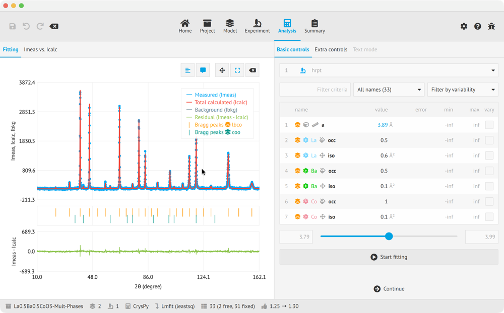
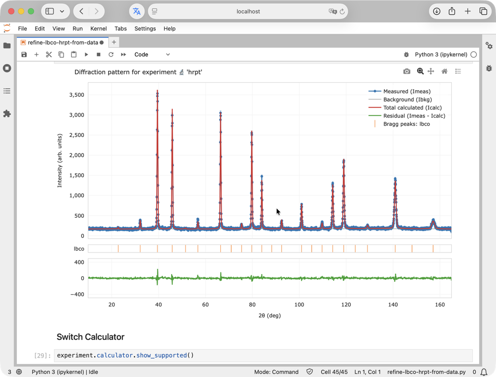
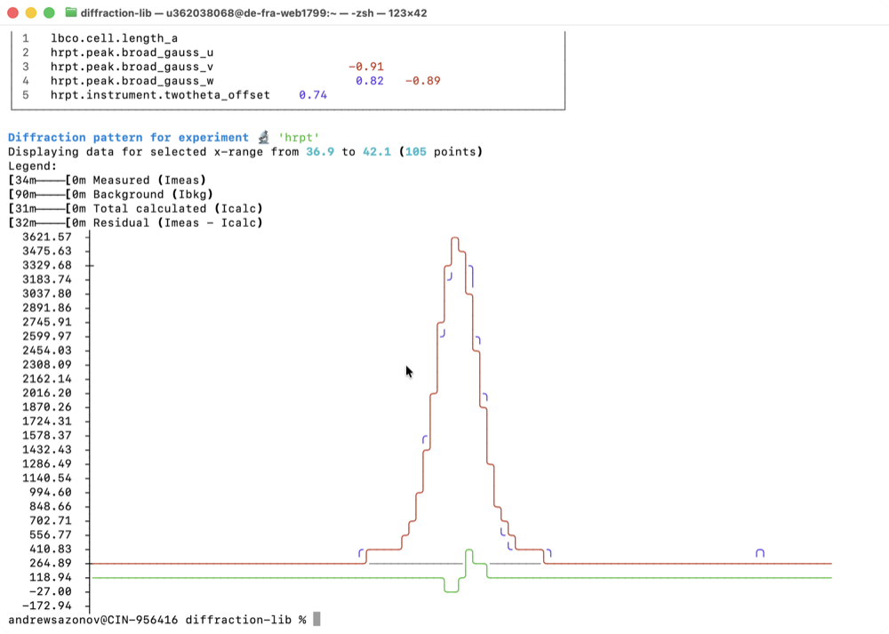

# Introduction

EasyDiffraction calculates diffraction patterns from crystallographic models and refines selected model parameters against measured observations. It helps you connect a proposed structure with experimental evidence and retain the choices behind the result.

## One product, several ways to work

The application provides a visual workspace in a browser or on a desktop. Python supports scripts and notebooks. The command line runs analyses declared by saved projects. These interfaces use the same project model and current diffraction engine.

<figure markdown="1">
<figcaption markdown="1">[**Application**](../application/index.md){ .ed-interface-head } Click through the workflow</figcaption>

</figure>
<figure markdown="1">
<figcaption markdown="1">[**Python**](../python/index.md){ .ed-interface-head } The same objects, in a notebook</figcaption>

</figure>
<figure markdown="1">
<figcaption markdown="1">[**Command Line**](../cli/index.md){ .ed-interface-head } The same project, one command</figcaption>

</figure>

Choose the interface that fits your task. A complete saved project lets you continue the analysis through another interface without rebuilding its scientific inputs by hand. Setup, available controls and file-writing behaviour are described in the respective interface sections.

## From a model to a result

A **structure** describes the crystalline material. An **experiment** describes how its pattern is measured or simulated, including instrumental effects and background. The **analysis** joins them: calculate a prediction, select parameters that may vary, and refine against observations when those observations are available.

The [Concept](concepts.md) page explains where this analysis sits after acquisition and reduction. The [analysis workflow](analysis-workflow/index.md) follows a project from its inputs to an assessed result and report.

## Start from a reproducible example

An [example project](examples.md) includes structures, experiments and starting conditions together. Use an example that matches your intended measurement, and read its provenance and reference comparison before treating it as a template for new work.

For your own analysis, retain the source of the structure and data, experimental conditions, fitting choices and software version. These two outputs serve different purposes: a report communicates the result to others, while the complete project is what you reopen to continue the analysis.

## Find the right documentation

The User guide explains the common scientific model. Start under [:lucide-monitor: Application](../application/index.md){ .ed-interface-link .ed-icon-label }, [:simple-python: Python](../python/index.md){ .ed-interface-link .ed-icon-label } or [:lucide-square-terminal: Command Line](../cli/index.md){ .ed-interface-link .ed-icon-label } for setup and a first refinement. Those sections follow the same Project → Structure → Experiment → Analysis → Report stages. [Physics](../physics/index.md) explains the calculations; [About](../about/index.md) covers the project, licensing, support and citation.
